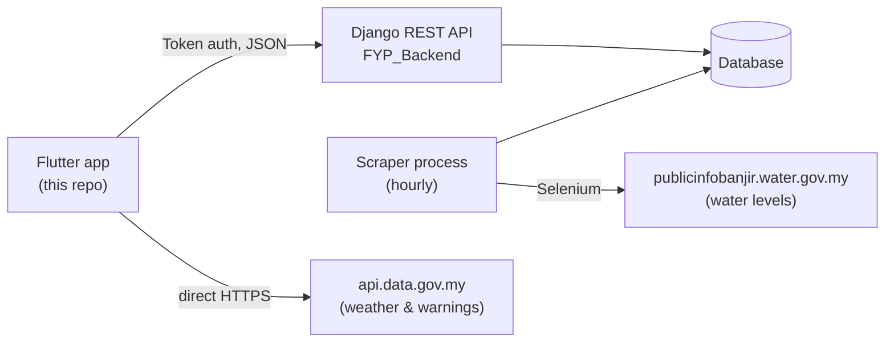

# Water Alert App

A Flutter app for flood preparedness in Malaysia. Users can check live river water levels and
weather warnings, find the nearest open flood shelter on a map, and donate supplies to flood
relief.

This is the mobile client. The backend (Django REST API + staff web dashboard) lives in
[FYP_Backend](https://github.com/chyiruay/FYP_Backend).

<!-- Add screenshots to docs/screenshots/ and they will show here -->
| Forecast | Water level | Shelter map | Donation |
|---|---|---|---|
|  |  |  |  |

## Features

- **Water levels** — readings for ~330 river stations across all 16 states, with each
  station's normal / alert / warning / danger thresholds.
- **Weather** — 7-day forecast, weather warnings and earthquake warnings from Malaysia's
  open-data API.
- **Shelter map** — Google Map of flood shelters. Picks the nearest *available* shelter to
  the user's location and opens turn-by-turn directions in Google Maps.
- **Donations** — browse needed items, pledge a quantity, and see your donation history.
- **Accounts** — register, log in (token auth), edit profile, change password.

## Architecture



- **Water levels** come from the backend. The government site has no API, so a separate
  scraper process saves an hourly snapshot to the database and the app reads the latest one.
- **Weather** is public open data, so the app calls `api.data.gov.my` directly.
- **Shelters** are downloaded once, and the distance is calculated on the phone with the
  haversine formula ([`lib/utils/distance.dart`](lib/utils/distance.dart), unit-tested).

### Project structure

```
lib/
  main.dart              app entry, routes
  app_theme.dart         shared ThemeData
  api/
    api_service.dart     all backend calls
    api_exception.dart   typed error thrown on failed requests
    weather.dart         api.data.gov.my client
  models/                plain data classes with fromJson
  screens/               one file per screen (forecast/, map, donation, profile, auth)
  utils/distance.dart    haversine distance
  widgets/base_layout.dart  shared scaffold + bottom navigation
test/                    unit tests
```

## Tech stack

Flutter 3 · Dart 3 · `http` · `shared_preferences` · `google_maps_flutter` · `location` ·
`url_launcher`

## Getting started

### Prerequisites

- Flutter SDK 3.x
- JDK 17 (`flutter config --jdk-dir=<path-to-jdk-17>`)
- An Android device or emulator
- The [backend](https://github.com/chyiruay/FYP_Backend) running and reachable from the device
- A Google Maps API key with **Maps SDK for Android** enabled

### 1. Add your Google Maps key

Create `android/secrets.properties` (it is gitignored):

```properties
MAPS_API_KEY=your-key-here
```

Without it the app still builds, but the map stays blank. Restrict the key in Google Cloud
Console to package `com.example.water_alert_app` and your signing certificate's SHA-1
(`cd android && ./gradlew signingReport`).

### 2. Run

```bash
flutter pub get

# Android emulator (10.0.2.2 is the emulator's address for your computer)
flutter run --dart-define=API_BASE_URL=http://10.0.2.2:8000

# Physical phone on the same Wi-Fi: use your computer's LAN IP
flutter run --dart-define=API_BASE_URL=http://192.168.x.x:8000
```

The backend must be started with `runserver 0.0.0.0:8000` for a phone to reach it.

### Tests

```bash
flutter test
flutter analyze
```

## Design decisions

- **API base URL is build-time config** (`--dart-define`) instead of a hardcoded IP, so
  switching between emulator, phone and a deployed server needs no code change.
- **The Maps key is not in source control.** It's read from a gitignored
  `secrets.properties` and injected into the Android manifest at build time.
- **Failed requests throw `ApiException`** so screens can tell "request failed" apart from
  "no data" and show a retry option instead of an empty list.

## Known limitations

- State is handled with `StatefulWidget` + `setState`; there's no state management library.
  That's fine at this size, but shared state like the login session is re-read per screen.
- Only Android has been tested. The iOS, web and desktop folders are Flutter scaffolding.
- The app downloads every shelter and sorts on the phone. If the list grows, a
  "nearest shelters" query belongs on the server (e.g. PostGIS).
